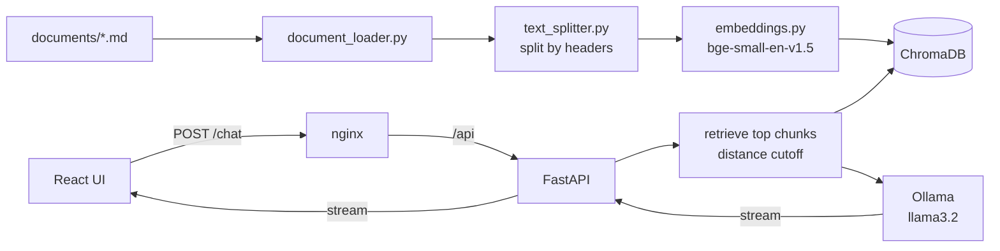

# Ask About Mohammad: a local RAG chatbot

An AI assistant that answers questions about my background (experience, projects, skills, education) using **Retrieval-Augmented Generation** with a **local LLM**. No external model APIs: documents, embeddings, vector search and the language model all run on my own machine.

> **Demo:** _add link here_  ·  **Screenshot:** _add `docs/screenshot.png`_

## What it does

- Answers only from my own documents, and says *"I don't know based on my knowledge base."* when the answer isn't there.
- Remembers the conversation per visitor (follow-ups like "what technologies did you use **there**?" work).
- Streams answers word by word, with instant answers for the suggested questions.
- Blocks obvious prompt-injection attempts and refuses to invent skills or credentials.
- Light/dark mode, profile sidebar with contact links and resume download.

## Architecture



**Request flow:** question → injection guard → (follow-up? add previous topic) → embed with the bge query prefix → ChromaDB search → drop chunks beyond `MAX_DISTANCE` → if nothing relevant, answer "I don't know" without calling the LLM → otherwise build a short prompt and stream the LLM answer.

## Tech stack

| Layer | Tools |
|---|---|
| LLM | Ollama, Llama 3.2 (3B) |
| Embeddings | Sentence Transformers, `BAAI/bge-small-en-v1.5` |
| Vector DB | ChromaDB |
| Backend | Python, FastAPI, Uvicorn |
| Frontend | React, Vite, nginx |
| Deployment | Docker, Docker Compose |
| Tests | pytest |

## Project structure

```
backend/        FastAPI app, RAG logic (chat.py), loader, splitter, embeddings, tests in checking/
frontend/       React chat UI (src/profile.js holds name, links, resume)
documents/      Markdown knowledge base (the only content the bot knows)
docker/         docker-compose.yml and the two Dockerfiles
.dockerignore   (project root)
```

## Run with Docker (recommended)

```
cd docker
docker compose up --build
```

Open **http://localhost:8080**. The first start downloads the `llama3.2` model (about 2 GB) into a volume. The backend image builds the vector index from `documents/` at build time. After editing a document:

```
docker compose build backend
docker compose up -d
```

## Run locally without Docker

```
# 1. Ollama
ollama pull llama3.2

# 2. Backend (from backend/)
python -m venv venv && venv\Scripts\activate        # Windows
pip install -r requirements.txt
python document_loader.py                           # builds the index
uvicorn main:app --host 127.0.0.1 --port 8000

# 3. Frontend (from frontend/)
npm install
npm run dev                                         # http://localhost:5173
```

After changing anything in `documents/` or `text_splitter.py`, run `python document_loader.py` again and restart the server.

## Configuration (environment variables)

| Variable | Default | Purpose |
|---|---|---|
| `LLM_MODEL` | `llama3.2` | Ollama model name |
| `APP_ENV` | `development` | `production` hides `/docs` |
| `RATE_LIMIT_PER_MINUTE` | `10` | Questions per IP per minute |
| `MAX_QUESTION_CHARS` | `500` | Longest accepted question |
| `SESSION_TTL_MINUTES` | `30` | Idle time before a conversation is dropped |
| `MAX_SESSIONS` | `200` | Conversations kept in memory |
| `PREWARM` | `1` | Pre-answer the 5 suggested questions at startup |
| `ALLOWED_ORIGINS` | localhost dev ports | CORS (not needed behind nginx) |

## Tests

Start the server (with a higher rate limit so the suite isn't throttled), then:

```
pip install pytest
python backend/checking/test_suite.py        # 22 checks
python backend/checking/CHECK_DB.py          # retrieval distances; use it to tune MAX_DISTANCE
```

Against Docker, set `API_BASE=http://127.0.0.1:8080/api` first. The suite covers grounded answers, trap questions (skills I don't have, off-topic questions), prompt-injection attempts, follow-up memory, session isolation and input validation.

## Design decisions and lessons

- **Retrieval quality came from the documents, not the model.** Splitting Markdown by headers, keeping each chunk's section path, and writing the knowledge base as short natural paragraphs (not bullet lists) fixed most wrong answers.
- **A distance cutoff plus an "I don't know" rule** stops the bot from answering off-topic questions or inventing skills. The cutoff was tuned with `CHECK_DB.py` on relevant and off-topic questions.
- **Small local models drift.** A 3B model once claimed a skill that wasn't in the documents, so the prompt names the rule explicitly and the test suite keeps a trap question for it.
- **Prompt length drives speed on CPU.** Prompt processing dominates latency, so the prompt is short, retrieval returns 3 chunks, and history keeps one turn.
- **Per-visitor sessions, one LLM call at a time.** The API serializes LLM calls, so visitors queue instead of slowing each other down.

## Known limitations

- On CPU, uncached answers take roughly 6–17 seconds. A GPU or a hosted model would make it much faster.
- The prompt-injection filter is keyword-based; the system prompt and "answer only from the documents" design are the second layer.
- Conversation history lives in memory and is lost on restart.
- Rate limiting by IP needs proxy headers configured when deployed behind another proxy.

## Updating the knowledge base

Edit the files in `documents/` (plain Markdown, one topic per section), rebuild the index, run `CHECK_DB.py` to confirm the right file still ranks first, and run the test suite.